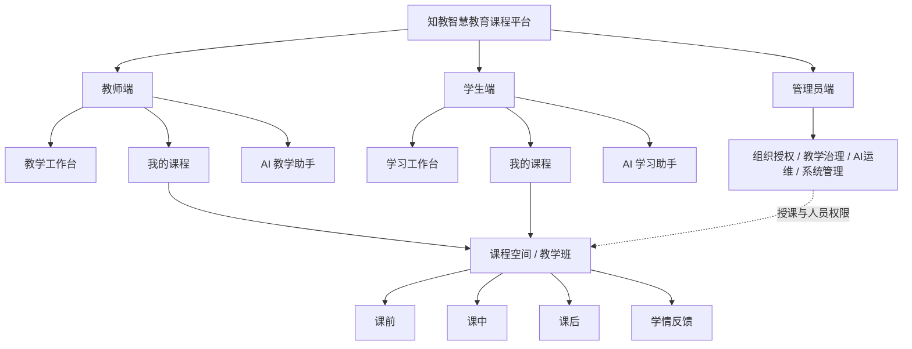

# 知教｜智慧教育课程平台功能架构优化方案 V3.0

> **文档定位**：三端产品信息架构、功能边界与团队协作开发基线（设计方案，不是已实现功能清单）  
> **版本**：V3.0 · 2026-10-21  
> **设计依据**：现有《功能架构优化方案 V2.0》、本次教师端导航截图、课前/课中/课后导航截图、师砺平台管理系统的多张菜单截图  
> **核心原则**：**教师端和学生端各保留两个一级业务入口；以“我的课程”承载课前、课中、课后及学情；两端共用一套教学活动数据；双方都接入各自职责的 AI 助手；管理员端按师砺平台截图组织菜单。**

## 0. V3.0 本轮定稿方向与评审状态

### 0.1 六项核心决定

1. **教师端一级业务导航仅保留「教学工作台」「我的课程」**。课前准备、课堂教学、课后作业与反馈、学情分析与教学改进，全部成为某门课程下的模块，不再平铺为教师端一级菜单。
2. **学生端采用对应的「学习工作台」「我的课程」**，保持二级结构一致、操作权限不同；学生只能查看与完成本人有权参与的教学任务。
3. **所有教学活动先进入课程，再选择教学班/课次/阶段**。工作台负责待办聚合和快捷入口，不创建另一套平行的教学功能。
4. **教师 AI 教学助手、学生 AI 学习助手均纳入产品明确范围**：采用“工作台快捷入口 + 课程上下文助手”的方式展示，不额外占据第三个一级菜单。
5. **管理员端一级目录及截图可见的二级目录沿用师砺平台管理系统**：工作台、教务组织、能力培养、学生学习、AI 大模型、基础设施、系统管理。对截图中折叠、未展示的三级菜单，不假定其原系统已有功能，单独列为“建议/待确认”。
6. **继承 V2.0 的核心闭环和安全边界**：课程空间与正式教学班分离，PPT 教学与学生跟页，签到/随堂题/作业联动，正式成绩经教师确认，AI 不得越权访问隐藏答案和私有数据。

### 0.2 文档的“确定”与“建议”

- **本次已明确的方向**：教师一级菜单名称与数量；课前、课中、课后归入「我的课程」；师生功能对应；各有 AI 助手；管理端按师砺平台参考图重构。
- **截图可核实的管理端内容**：管理端七个一级菜单以及下文列出的可见子项名称。
- **V3.0 设计建议、尚待团队拍板**：学生一级菜单使用「学习工作台」的命名；管理员不同子项的具体业务实现、未展开的三级菜单；AI 首版实现深度；是否纳入证书和实训的实质业务；前后端路线命名。

### 0.3 优先级标记

| 标记 | 含义 | 开发约束 |
|---|---|---|
| `M0` | 必须跑通的教学闭环 | 不允许只有空白菜单或假数据按钮 |
| `M1` | 首版逐步完善 | 可分批交付，入口应与真实功能同步开放 |
| `M2` | 后续增强 | 不在首版默认展示未完成功能 |
| `待确认` | 来源截图不足或产品范围未批准 | 先保留方案，不作为已确定需求承诺 |

> M0/M1/M2 沿用 V2.0 的实施优先级概念，不直接替代需求分析文档原有的 P0/P1/P2；发生范围差异时需要形成评审记录。

---

# 一、整体信息架构：课程是中心，工作台是入口

## 1.1 三端关系



**解释**：教师的“发布”和学生的“接收”，教师的“上课”和学生的“跟课”，教师的“批改”和学生的“查看评价”，不是两套独立业务；它们必须关联同一个课程、教学班、教学活动实例和学习记录。

## 1.2 核心对象（延续 V2.0）

| 对象 | 定义 | 主要关系 |
|---|---|---|
| 课程空间 | 教师可创建的内容容器，含课程大纲、章节、课件、题库、知识点 | 一门课程空间可供多个教学班复用 |
| 正式课程目录 | 由教务组织维护的正式课程编码、归属和学期信息 | 关联经授权的课程空间 |
| 教学班 | 学生实际参与授课、签到、提交作业的权限与数据边界 | 关联课程、教师、学期、学生名单 |
| 教学单元/课次 | 本次授课与课程章节、知识点、资源的组织单元 | 每个课次串联课前、课中、课后 |
| 备课方案 | 课件顺序、讲授要点、待发起活动模板的组合 | 未发起的模板不得自动向学生开放 |
| 课堂会话 | 一次实际开始、进行、结束的同步课堂 | 关联教学班、教师、课件状态、活动实例 |
| 教学活动实例 | 一次具体预习、签到、随堂题、作业、补学任务 | 包含发布时间、对象快照和提交状态 |
| 学习证据 | 学生有效预习、自测、签到、答题、提交等记录 | 用于可核查的学情统计 |
| 正式评价 | 教师确认发布后的得分和评语 | AI 仅提供草稿/建议，不直接定为正式成绩 |
| AI 会话 | 某角色在某课程或工作台中的问答与工具请求 | 需要绑定身份、课程范围、可访问资源版本 |

## 1.3 菜单层级与页面规则

- **一级导航**只区分“工作台”和“我的课程”，避免把每一个教学阶段扩成平台级入口。
- **二级入口**以“课程列表”以及“课程详情内页签”为主；一门课程进入后才显示课前、课中、课后等阶段。
- **三级操作**（上传课件、发起签到、设置倒计时、批改一份作业等）放在页面按钮、工具栏、抽屉、弹窗中，不额外增加侧栏层数。
- **统一课程上下文**：课程名称、教学班、学期、教学单元/课次展示在课程页面顶部；切换教学班后所有任务、提交、统计随之更新。
- **工作台快捷卡片可以直达任务**，但实际打开的是「我的课程」中的对应页面，不存在两个版本的业务页面。
- **AI 助手可从工作台和课程详情唤起**；在课程内自动绑定当前课程/班级/阶段，不新造一个孤立的“AI 大模型”业务区。
- **课堂进入沉浸式视图**，教师操作面板、投影公开画面、学生跟课画面相互隔离。

---

# 二、教师端 V3.0：两个一级菜单

## 2.1 建议真实导航树

```text
【教师端】
├─ 教学工作台                            （一级菜单）
│  ├─ 教学总览                          （工作台卡片/默认页）
│  ├─ 今日课程 / 快捷上课                （工作台区域）
│  ├─ 教学待办                          （工作台区域）
│  ├─ 班级消息 / 公告                    （工作台区域）
│  └─ AI 教学助手                        （工作台快捷入口）
│
└─ 我的课程                              （一级菜单）
   ├─ 课程列表 / 创建课程                （一级菜单下的入口）
   └─ 点击某门课程 → 进入【课程详情】
      ├─ 课程概览
      ├─ 课程建设                        （章节 / 资源 / 题库 / 教学班）
      ├─ 课前准备                        （教学阶段）
      ├─ 课堂教学                        （教学阶段，沉浸式授课）
      ├─ 课后作业与反馈                  （教学阶段）
      ├─ 学情分析与教学改进              （贯穿三阶段）
      └─ AI 教学助手                      （当前课程上下文）
```

> **关键**：这里的“课程概览／课程建设／课前准备……”是进入某门课程后的顶部标签或课程内导航，**不是平台左侧的一串一级菜单**。建议首次进入「我的课程」展示课程卡片，再点击具体课程显示阶段模块。

## 2.2 教学工作台——聚合、提醒、直达，不重复建设

| 页面区块 | 教师看到什么 / 可以做什么 | 优先级 |
|---|---|---|
| 教学总览 | 授课课程数、本周课次、进行中课堂、待批改作业、未完成预习提醒、近期教学进度 | M0 |
| 今日课程 | 今日教学班、课次、时间、预设备课方案，按钮「开始上课／返回课堂」 | M0 |
| 教学待办 | 待发布预习、待开启活动、待批改、待确认成绩、补学提醒；跳到所属课程和教学班 | M0 |
| 班级公告/消息 | 教学班公告、学生留言、任务截止提醒及课程内反馈 | M1 |
| AI 教学助手 | 一键打开教学助手；若从工作台进入，先选择课程或使用不涉私有课程的通用问答 | M0 基础入口；M1 丰富能力 |

## 2.3 我的课程 → 课程概览与课程建设

### A. 课程列表、建课与授权

- **课程列表 `M0`**：按“我的自建课程／已绑定正式教学班／参与协同授课／已归档课程”筛选；卡片显示课程名称、学期、关联教学班、待办、最近一次课堂。
- **创建课程 `M0`**：名称、简介、教学目标、封面、章节框架；允许复制已有课程；新建课程默认属于教师个人课程空间。
- **正式教学班绑定 `M0`**：管理员维护正式课程、教学班和师生关系；教师只能选择授权范围内的教学班发布实际任务。
- **多教学班复用 `M0`**：同一份课件/题库可复用，但预习发布、签到、作业提交、成绩等按教学班隔离。

### B. 课程建设（课程内部模块）

| 功能 | 说明 | 优先级 |
|---|---|---|
| 课程大纲与章节 | 设置章、节、知识点、授课目标；排序、编辑、停用 | M0 |
| 课程资源 | 上传/预览 PPTX、PDF、视频、文档、图片；按章节、课次和知识点归档；版本控制 | M0 |
| 题库与评分标准 | 选择、判断、简答等题型；知识点、答案与解析；主观题评分标准 | M0 |
| 教学班设置 | 查看授课班级、学生人数、任课/协同教师、授课学期、开放范围 | M0 |
| 课程复制/共享 | 跨教学班复用内容；协同教师编辑权限；校级公开共享按审核策略 | M1 |

**不重复开发规则**：课前选择的预习资料、课中使用的 PPT、课后布置的作业题均引用课程资源/题库；不为“课前资料”和“课后资料”各做一套独立文件库。

## 2.4 我的课程 → 课前准备

| 功能入口 | 教师操作 | 对应学生端结果 | 优先级 |
|---|---|---|---|
| 授课方案/备课包 | 选课件、排列讲授顺序、关联知识点、加入活动模板 | 在未发布/开始之前不展示教师私有方案 | M0 |
| 预习资源发布 | 选择课程资源或 PPT 指定页、导学内容、视频，设置开放时间/教学班 | 学生“课前学习”看到已开放资源 | M0 |
| 预习任务/测验 | 选择题库题、设置截止时间、完成标准、公布规则 | 学生收到待完成预习、自测、提交结果 | M0 |
| 课堂活动预设 | 预设签到、随堂题、课堂小作业模板和预计触发位置 | 学生此时不能提前签到或获取未公布题目 | M0 |
| 预习学情/课前诊断 | 查看完成率、有效自测和知识点错题；给未完成者提醒 | 学生看到预习完成状态和已授权的反馈 | M0 |
| AI 辅助备课 | 基于有权访问的课件生成导学、课堂题、备课建议草稿 | 仅教师审核并发布后学生可见 | M1 |

## 2.5 我的课程 → 课堂教学

**课堂教学是一个页面中的工作模式，不是每个能力再单独跳转的后台列表。**

- **课堂启动 `M0`**：选教学班与备课方案；支持不使用方案直接从课件开始；开始/暂停/结束由服务端记录。
- **PPT 讲授 `M0`**：分页预览、翻页、跳页、全屏、切换公开讲授素材；向学生端广播当前公开页与版本。
- **学生同步跟课 `M0`**：教师看到当前加入人数及连接状态，学生断线后从服务器恢复最新页；不把 PPT 同步等同于视频直播。
- **一键课堂互动 `M0`**：签到码/二维码、随堂单选/多选/判断、课堂小作业，均可从预设模板启动或临时创建。
- **即时学情 `M0`**：本次参与人数、当前题目已答/未答、选项分布、正确率、知识点错误项；教师用数据决定是否重讲。
- **结束归档 `M0`**：课堂会话、实际课件版本、活动和已授权公开结果归档，后续进入课后反馈。
- **AI 课堂助手 `M1`**：根据教师正在讲的**已授权内容**给出问题建议、讲授思路、课堂总结草稿；在教师私有区展示，未经教师确认不公开。
- **高级互动 `M2`**：投票、讨论、抢答、批注、白板、音视频直播等在需求确认后独立建设。

**课堂三种视图**：教师私有控制台（可看答案、名单和 AI 建议）／投影公开视图（只放已授权展示内容）／学生跟课视图（只看当前公开课件、本人任务和本人反馈）。

## 2.6 我的课程 → 课后作业与反馈

| 功能入口 | 教师操作 | 对应学生端结果 | 优先级 |
|---|---|---|---|
| 作业发布 | 题库选题或自定义主观题/文件任务，设置分值、截止时间和允许提交次数 | “课后学习”收到作业 | M0 |
| 作业管理与批改 | 查询提交/未提交；客观题规则判分，主观题人工批改 | 学生看到提交状态和“待评价”状态 | M0 |
| 成绩确认与反馈 | 教师确认正式成绩与评语后发布；更正留痕 | 学生看到正式成绩、解析和评语 | M0 |
| 错题分析 | 按题目/知识点/班级分析失分与共性问题 | 学生错题本归集已公布答案的错题 | M0 |
| 课后回顾 | 开放课堂课件、已发布结果、补充材料 | 学生回顾允许访问的课件及反馈 | M0 |
| 补学/巩固 | 按知识点或指定学生布置资料和补学练习 | 学生完成补学，形成新学习证据 | M1 |
| AI 辅助评价 | 提供主观题建议得分、得分点、评语草稿；教师逐份确认 | 只有教师正式发布后才呈现为成绩 | M1 |

## 2.7 我的课程 → 学情分析与教学改进

- **班级学情总览 `M0`**：预习完成、签到、随堂题、作业提交、已发布成绩；明确时间、分母、统计口径。
- **知识点证据 `M0`**：按已关联知识点的真实题目和学习记录统计，保留样本量、来源与时间。
- **学生个体学情 `M1`**：仅查询本教师获授权教学班的具体学生学习情况。
- **教学调整 `M1`**：从高频错题或薄弱知识点一键生成“下次课前准备/课堂题/补学”草稿。
- **AI 学情解读 `M1`**：解释已有数据、提示值得关注的知识点；禁止把浏览时长包装成准确“掌握度百分比”。

---

# 三、学生端 V3.0：与教师端对应的两个一级菜单

## 3.1 建议真实导航树

```text
【学生端】
├─ 学习工作台                            （一级菜单；与教学工作台对应）
│  ├─ 学习总览 / 今日待办                （工作台卡片/默认页）
│  ├─ 正在上课 / 一键加入                （工作台快捷入口）
│  ├─ 作业与预习截止提醒                （工作台区域）
│  ├─ 学习通知 / 课程公告                （工作台区域）
│  └─ AI 学习助手                        （工作台快捷入口）
│
└─ 我的课程                              （一级菜单）
   ├─ 在修课程列表                      （一级菜单下的入口）
   └─ 点击某门课程 → 进入【课程详情】
      ├─ 课程概览
      ├─ 课程资料                        （仅查看教师已开放的资源）
      ├─ 课前学习                        （与教师“课前准备”对应）
      ├─ 同步课堂                        （与教师“课堂教学”对应）
      ├─ 课后学习                        （与教师“课后作业与反馈”对应）
      ├─ 我的学情                        （与教师“学情分析”对应）
      └─ AI 学习助手                      （当前课程上下文）
```

**设计解释**：教师“创建/发布/批改”，学生“阅读/参与/提交/查看”；两端的栏目结构相似，却不强行逐项显示相同后台按钮。学生手机端优先展示“学习工作台、我的课程、正在上课、待办”快捷操作，快捷操作仍落到两大业务入口体系中。

## 3.2 学习工作台

| 页面区块 | 学生操作 | 优先级 |
|---|---|---|
| 今日待办 | 待预习、正在进行的课堂、待签到答题、作业、补学；点击直达课程任务 | M0 |
| 正在上课 | 展示本人教学班当前课堂，按钮「立即加入／返回课堂」 | M0 |
| 截止提醒 | 临近截止的预习和作业、尚未完成任务 | M0 |
| 公告与消息 | 查看任课教师公开的课程公告、成绩发布通知、反馈 | M0 |
| AI 学习助手 | 通用学习问题与课程问答快捷入口；有课程上下文时优先引用该课程公开资料 | M0 基础入口；M1 丰富能力 |

## 3.3 我的课程 → 课程概览与课程资料

- 在修课程列表：只展示本人所属教学班开放的课程，课程卡片关联教师、学期、最近教学活动和当前任务。
- 课程概览：课程目标、章节/知识点、公开教学安排、当前章节进度；不出现教师备课备注或题库隐藏答案。
- 课程资料：按教师授权和开放时间访问 PPT/PDF、文档、视频；下架或撤权后旧链接同样失效。

## 3.4 我的课程 → 课前学习

- **我的预习 `M0`**：待开始、进行中、已完成、已截止，以及对应时间要求。
- **资料学习 `M0`**：学习教师开放的 PPT 指定页、阅读资料和视频；支持基本进度保存。
- **预习测验 `M0`**：答题、草稿、提交确认，按照教师授权时点查看解析。
- **预习反馈 `M0`**：是否完成、已发布解析、未完成提醒；除非有明确规则，未预习不应自动阻止课堂签到。
- **AI 课前预习引导 `M1`**：解释公开预习资料、提示复习重点，禁止提供未开放题目答案。

## 3.5 我的课程 → 同步课堂

- **加入课堂 `M0`**：在有权参与的教学班中一键加入；断线重连恢复本人签到、作答及最新公开课件页。
- **同步观看 `M0`**：看到教师当前公开 PPT 页；弹出课堂任务后仍能回到跟课；是否可自主翻页按教师设置。
- **签到 `M0`**：扫码/输入短时码，显示成功、迟到或失败原因；重复点击不得新增有效记录。
- **随堂题 `M0`**：答题、倒计时、有效提交反馈；只有教师关闭并公开答案后才能查看解析。
- **课堂小作业 `M0`**：填写文本/上传附件，记录提交状态，后续进入统一作业列表。
- **课堂回顾 `M0`**：查看本人参加记录与教师已公开的课堂资料/结果。
- **AI 跟课解释 `M1`**：针对当前已公开 PPT 页解释概念，不泄露教师私有备注、未公布参考答案或其他学生数据。

## 3.6 我的课程 → 课后学习、我的学情

| 学生功能 | 对应教师行为 | 优先级 |
|---|---|---|
| 我的作业／作答提交 | 教师发布作业 | M0 |
| 提交状态、补交／改交规则 | 教师设置截止与提交规则 | M0 |
| 正式成绩、评语、解析 | 教师确认并发布评价 | M0 |
| 错题本与重做 | 教师公布解析；后台归集错题 | M0 |
| 课后资料/课堂回顾 | 教师开放课后资料与课堂记录 | M0 |
| 补学与巩固 | 教师指定资源或补学任务 | M1 |
| 我的学情 | 教师端班级统计引用同一学习记录，学生只看自己的视角 | M1 |
| AI 错题讲解／学习计划 | 仅基于本人有权限的教材、公开解析和学习证据生成 | M1 |

---

# 四、教师端与学生端的功能对应矩阵（开发必须对齐）

| 教学环节/对象 | 教师端动作 | 学生端动作 | 必须共享的对象/状态 | 管理端关注点 |
|---|---|---|---|---|
| 课程与教学班 | 建课、申请/选择教学班 | 查看已加入课程 | 课程 ID、教学班 ID、成员关系 | 课程/班级/人员授权 |
| 章节与资源 | 编辑章节点、上传并开放资料 | 浏览已开放资料 | 资源版本、章节、开放范围 | 资源治理与文件安全 |
| 课前预习 | 发布资料和测验 | 预习、作答、提交 | 预习任务 ID、目标名单、进度 | 汇总完成情况 |
| 课前诊断 | 查看完成率与错题 | 查看自己的预习反馈 | 学习证据、知识点关联 | 教学过程分析（授权范围） |
| 开始课堂 | 开始/结束课堂会话 | 加入/退出课堂 | 课堂会话 ID、状态 | 课堂服务运行状态 |
| PPT 同步 | 控制公开页 | 跟随公开课件 | 课件版本、公开页序号 | 同步服务监控 |
| 签到 | 发起、结束、修正 | 有效签到 | 同一签到活动实例和提交记录 | 出勤统计、修正审计 |
| 随堂答题 | 发题、结束、公布 | 限时作答、看已公布结果 | 题目/活动 ID、公布状态 | 活动运行统计 |
| 课堂小作业 | 发任务、查看提交 | 提交任务 | 统一提交/批改记录 | 异常与质量汇总 |
| 课后作业 | 发布与管理 | 完成与提交 | 作业 ID、提交版本 | 作业运行状态 |
| 批改与成绩 | 批改、确认、发布/修正 | 仅查看已发布正式成绩 | 评分版本、发布状态 | 质量分析；默认不可替教师改分 |
| 错题与补学 | 分析错题、发布补学 | 查看错题、完成补学 | 题目、知识点、补学记录 | 授权下汇总分析 |
| 学情分析 | 看班级和授权学生 | 只看本人情况 | 同源学习证据与统计口径 | 学院/班级汇总和审核 |
| AI 助手 | 生成备课/评价建议草稿 | 答疑/错题讲解 | 角色权限、资源来源、会话日志 | 模型配置、配额、审计 |

**强制开发约束**：上述对应关系必须使用同一个活动/任务/课堂身份标识；禁止教师端一套签到表、学生端另存一套签到表；禁止教师端和学生端分别计算互相冲突的“完成状态”。

---

# 五、双 AI 助手的定位与功能边界

## 5.1 教师「AI 教学助手」

**典型入口**：教学工作台快捷按钮；任一课程详情固定的“AI 教学助手”入口；备课、出题、批改、学情界面的上下文唤起按钮。

| 能力 | 输入与输出 | 初期范围 |
|---|---|---|
| 课程知识问答 | 输入问题并可选择当前课程/已授权课件；返回解释和可追溯资料来源 | M0 基础问答 |
| 备课方案建议 | 输入教学目标、课时、章节；生成备课方案**草稿** | M1 |
| PPT 内容提炼 | 对选中、已解析的课件页提炼要点与教学讲解提示 | M1 |
| 预习/随堂/作业题生成 | 基于知识点和已授权课件生成题目与解析草稿 | M1 |
| 作业初评 | 对可评估的提交内容给出评分建议、证据与不确定项 | M1，教师确认 |
| 学情解读 | 对真实统计进行解释并提出下一轮教学建议 | M1 |

**不可自动执行**：未经确认发布预习/课堂题/作业、公布参考答案、修改正式成绩、批量泄露学生提交原文。

## 5.2 学生「AI 学习助手」

**典型入口**：学习工作台快捷按钮；课程详情固定“AI 学习助手”；公开课件、错题、预习和课后页面的“问 AI”按钮。

| 能力 | 输入与输出 | 初期范围 |
|---|---|---|
| 学习问答 | 基于学生有权访问的课程资料解答问题，标明课程资料来源 | M0 基础问答 |
| 当前 PPT 解释 | 围绕已公开课件页讲解术语和知识点 | M1 |
| 预习引导 | 提示重点与思考方向，不能直接取出尚未公布的标准答案 | M1 |
| 已公布错题讲解 | 解释错误原因、正确思路和关联章节，支持分步提问 | M1 |
| 个性化复习建议 | 根据本人真实作业和测验记录，推荐本课程已授权资料 | M1/M2 |

**权限区分**：学生助手不能因为与教师助手使用同一个模型，就具备访问教师备课区、标准答案、其他学生学情或未发布成绩的权限。

## 5.3 AI 统一技术与安全规则

1. **统一模型网关**：可按角色/场景选择模型、配额、超时降级策略；教师和学生 UI 不必接入两套独立模型配置。
2. **检索前/后双层授权**：服务端先判断课程、班级、资源版本和发布状态；AI 检索结果仍应二次过滤，不仅依靠前端隐藏菜单。
3. **资料版本与出处**：引用当前有效的课件、章节、公开解析，展示可定位到资源/页码的出处；无资料依据时说明是通用解释。
4. **防止未公布答案泄漏**：学生对未完成/未公布的作业，默认给方法提示、概念讲解，不查询教师隐藏答案字段。
5. **人审和可追溯**：AI 生成的题目、通知、评分、反馈是草稿，教师确认后才成为正式业务操作；记录操作人及最终确认人。
6. **可用性降级**：AI 超时/配额耗尽时，教学、签到、作业和正常资料阅读继续可用。
7. **敏感数据保护**：不将批量学生个人资料无必要地送入模型，日志应区分元数据与敏感正文并有保留期限。

> **交付建议**：用户要求两端均有 AI 助手，因此 V3.0 将“可用的基础问答 + 正确课程权限 + 统一入口”设为 M0；复杂 AI 备课、自动批改、个性化推荐仍按 M1/M2 分期，不以空壳聊天框替代功能。

---

# 六、管理员端 V3.0：参照师砺平台管理系统

## 6.1 参考原则与边界

**按照本次截图可见结构，管理端的一级菜单固定为以下七组，名称不再沿用 V2.0 管理端自拟的八组名称。** 截图只能确认部分栏目名称和展开箭头，不能证明隐藏子页的确切名称或业务逻辑；本章节将“图片可见目录”和“知教平台实际建议职责”区分描述。

### 管理端侧边导航树（复刻图片可见层级）

```text
【管理员端：参考师砺平台管理系统】
├─ 工作台
│
├─ 教务组织
│  ├─ 组织架构管理
│  ├─ 班级管理
│  ├─ 教师管理
│  ├─ 学生管理
│  ├─ 留言互动
│  └─ 学期管理
│
├─ 能力培养
│  ├─ 评价指标管理
│  ├─ 证书配置
│  ├─ 教学过程分析
│  ├─ 教学问题研判
│  ├─ 实训课程                  （截图中存在展开箭头，内部层级待确认）
│  ├─ 实训任务                  （截图中存在展开箭头，内部层级待确认）
│  ├─ 管理员看板
│  └─ 教师工作台
│
├─ 学生学习
│  ├─ 校园资讯
│  ├─ 学习首页
│  ├─ 我的课程
│  ├─ 任务中心
│  ├─ 能力分析
│  ├─ 单项能力评测
│  ├─ 个人中心
│  └─ 我的留言
│
├─ AI 大模型
│  ├─ AI 对话
│  └─ 控制台                    （截图中存在展开箭头，内部层级待确认）
│
├─ 基础设施
│  ├─ 配置管理
│  ├─ 文件管理                  （内部层级待确认）
│  ├─ 监控中心                  （内部层级待确认）
│  └─ 定时任务
│
└─ 系统管理
   ├─ 用户管理
   ├─ 角色管理
   ├─ 菜单管理
   ├─ 字典管理
   ├─ 通知中心                  （内部层级待确认）
   ├─ 审计日志                  （内部层级待确认）
   ├─ OAuth 2.0                 （内部层级待确认）
   └─ 第三方登录                （内部层级待确认）
```

**注意**：上述是参考截图的**导航名称与可见层级**，不是声称已核实师砺平台所有隐藏页面；其中“证书配置／实训课程／实训任务／单项能力评测”等是否在知教项目中完整落地，需要单独立项或按优先级裁剪其真实业务，不能直接展示不可用的空白页面。

## 6.2 工作台（管理首页）

| 子功能（V3 建议） | 说明 | 优先级 |
|---|---|---|
| 管理总览 | 按授权范围统计组织、班级、师生、课程、资源和教学活动数量 | M0 |
| 待办事项 | 教务导入错误、课程教学班授权申请、公开资源审核、系统异常 | M0/M1 |
| 运行概况 | 课堂同步、课件转换、任务提交、AI 服务状态摘要 | M1 |

## 6.3 教务组织（参考截图名称逐项落实）

| 截图可见菜单 | 知教 V3 具体职责建议 | 优先级 |
|---|---|---|
| 组织架构管理 | 学校—学院—专业—教学组织层级的创建、编辑、停用、归属授权 | M0 |
| 班级管理 | 行政班与**教学班**区分；正式教学班关联课程、学期、教师、学生 | M0 |
| 教师管理 | 教师基本信息、任教教学班、协同授课关系、有效状态 | M0 |
| 学生管理 | 学生必要基础信息、教学班名单、导入与调班记录 | M0 |
| 留言互动 | 处理课程/平台留言的管理权限、反馈与申诉流转；普通教师回复仍在教师端 | M1 |
| 学期管理 | 学年学期、起止日期、开课和结课状态、历史归档时间 | M0 |

**必要补充（页面操作而非另造一级目录）**：教务数据批量导入、冲突预览、失败明细、成员变更记录和权限审核分别并入组织架构/班级/人员页面。

## 6.4 能力培养

| 截图可见菜单 | 知教 V3 业务建议 | 优先级及说明 |
|---|---|---|
| 评价指标管理 | 维护可解释的课堂参与、预习、作业、知识点等评价指标及其版本；不强制生成“综合能力分” | M1 |
| 证书配置 | 预留证书类型、获取规则、模板配置；只有确认需要证书业务后开发 | 待确认/M2 |
| 教学过程分析 | 按课程/学院/教学班汇总预习、课堂签到、答题、作业进度和反馈 | M1 |
| 教学问题研判 | 根据明确的数据证据形成候选问题，教务审核、通知教师和跟踪处理 | M1/M2 |
| 实训课程 | 作为实训课程配置、内容与关联模块的上层入口，三级菜单待参照实际系统进一步核对 | 待确认/M2 |
| 实训任务 | 实训任务模板、发布情况、完成/评测情况；不应与普通作业重复创建提交引擎 | 待确认/M2 |
| 管理员看板 | 面向教务管理角色的教学质量、参与和运行汇总大屏 | M1 |
| 教师工作台 | 仅作经授权的教学端工作台入口/演示视图或管理工作入口，**不允许管理员默认冒用教师身份修改成绩** | 待确认 |

**范围控制**：师砺参考图中的“能力培养”是一个较大的业务域；知教首版仍以真实教学闭环为核心，证书/综合评测/独立实训体系必须评审后排期，不因菜单存在就自动纳入 M0。

## 6.5 学生学习

| 截图可见菜单 | 知教 V3 建议职责 | 优先级及权限 |
|---|---|---|
| 校园资讯 | 校园级资讯、课程公共公告的发布和审核 | M1 |
| 学习首页 | 面向管理人员的学生学习入口配置/授权预览 | M1，不能越权看个人信息 |
| 我的课程 | 学生课程入口、课程展示与开放配置的管理视图 | M0/M1，不能代学生提交 |
| 任务中心 | 教学任务的汇总运行统计和异常工单 | M1 |
| 能力分析 | 经过批准的指标分析与数据核验 | M1/M2，不推断不存在的能力分数 |
| 单项能力评测 | 专项能力测评方案和项目配置（前提是项目真的需要） | 待确认/M2 |
| 个人中心 | 个人中心的字段/资料展示规则或个人账户入口 | M1 |
| 我的留言 | 学生留言功能的管理视图或入口配置 | M1 |

**特别说明**：截图将“学生学习”列在统一平台的侧栏，不意味着管理员可以代学生参加课堂、查看任何学生的全部隐私，或将学生端与管理端做成完全相同的业务操作。知教要保留角色、数据范围与操作权限的服务端校验。

## 6.6 AI 大模型

| 截图可见菜单 | 知教 V3 建议职责 | 优先级 |
|---|---|---|
| AI 对话 | 管理员授权的 AI 对话入口，用于平台/课程管理辅助问答，不默认读取所有学生数据 | M1 |
| 控制台 | 模型供应商与连接状态、配置参数、应用场景、角色配额、服务限流、错误日志与调用统计；具体三级菜单名称待确认 | M1 |

教师“AI 教学助手”、学生“AI 学习助手”属于各自业务端；管理员“AI 大模型”管理其底层模型能力、服务状态和权限策略，**三者共享治理底座而非共享私有聊天历史**。

## 6.7 基础设施

| 截图可见菜单 | 知教 V3 建议职责 | 优先级 |
|---|---|---|
| 配置管理 | 平台运行参数、文件限制、任务调度和消息配置 | M0/M1 |
| 文件管理 | 已授权文件、存储空间、课件转换结果、下载策略与清理 | M1 |
| 监控中心 | 应用可用性、课堂连接、课件转换、数据库/缓存和任务异常指标 | M1 |
| 定时任务 | 任务开放/截止、资源处理、统计汇总、通知重试等调度及运行日志 | M1 |

## 6.8 系统管理

| 截图可见菜单 | 知教 V3 建议职责 | 优先级 |
|---|---|---|
| 用户管理 | 账号、状态、初始化/重置凭证、会话撤销和关联身份 | M0 |
| 角色管理 | 教师/学生/教务管理员/超级管理员及细分角色、按钮操作权限 | M0 |
| 菜单管理 | 菜单树、路由、可见性、按钮权限、角色分配；不能仅凭前端隐藏控制权限 | M0 |
| 字典管理 | 统一管理学期状态、活动状态等有边界的枚举和可配置字典 | M1 |
| 通知中心 | 系统公告、站内通知模板、发送记录和失败重试 | M1 |
| 审计日志 | 登录、授权、资源变更、课堂修正、成绩确认/撤回、导出、AI 调用审计 | M0 |
| OAuth 2.0 | 对第三方授权相关能力预留管理入口；是否需要认证服务端要另行评估 | 待确认/M2 |
| 第三方登录 | 学校统一认证等外部身份接入方案；接口、授权和安全评审通过后实现 | 待确认/M2 |

## 6.9 管理角色与菜单显示规则

- **教务管理员**：优先开放「工作台／教务组织／能力培养中的授权统计／学生学习中的授权管理」；不得擅自扩大学院、班级、学期范围。
- **超级管理员**：开放「基础设施／系统管理／AI 大模型控制台」及必要的跨域运行汇总，但不应仅因“超管”身份即可查看所有学生作答原文或随意修改成绩。
- **内容审核人员（可选）**：只开放授权资源审核与公告治理，避免为了审核资源赋予全部教务管理权限。
- **同一账号兼多角色**：前端可在角色允许时切换工作视角；切换不会绕过后端权限验证。
- **复用同一套账户、权限、菜单、组织和日志底座**，不要为教师、学生、管理员新建三个彼此孤立的用户体系。

---

# 七、关键页面布局规范

## 7.1 教师端左侧导航（简化目标）

```text
┌────────────────────────────────────────────┐
│ 左侧              │ 右侧内容区              │
│                   │                          │
│ 教学工作台        │ 默认：工作台卡片         │
│ 我的课程          │ 点击课程后：             │
│                   │ 课程名 | 班级 | 学期     │
│                   │ 概览 | 建设 | 课前       │
│                   │ 课堂 | 课后 | 学情       │
│                   │ 主页面内容               │
│                   │              [AI 助手]   │
└────────────────────────────────────────────┘
```

- 「我的课程」默认显示课程卡片，不卡在抽象菜单页。
- 点击具体课程后，右侧顶部显示课程名、当前教学班、学期和课程内阶段标签；切换阶段不用返回侧边栏。
- 进入授课时优先隐藏复杂管理导航，切换为沉浸式课堂；课堂未结束时随时可返回。
- 使用侧边悬浮按钮或抽屉呈现 AI 助手，确保不挡 PPT 翻页、签到、交作业等关键操作。

## 7.2 学生端布局

- 桌面端左侧只需「学习工作台」「我的课程」。
- 课程内部与教师端按同一阶段顺序排列：概览→课前→课堂→课后→我的学情；学生不看“课程建设”编辑操作。
- 手机端在工作台优先展示“立即加入课堂、继续预习、去交作业”；可用紧凑底部快捷栏，**不构成第三套业务导航结构**。
- AI 助手可在课程页、学习资料页打开，手机端应允许随时关闭并恢复原学习位置。

## 7.3 管理端布局

- **保留师砺平台截图的管理框架风格**：左侧多业务分组树、分组展开/折叠、顶部面包屑和多页签工作区。
- 管理员需要多模块切换，允许其比师生端有更多一级菜单，不强制管理端也只保留两个一级菜单。
- 采用菜单权限驱动：有权限才显示可进入的菜单；每个接口单独执行后端权限校验。
- 截图展示的样式、栏目和层级是 UI 参考，不能据此推断后端实现技术或完整业务能力。

---

# 八、课程工作流与关键状态

## 8.1 从建课到下一次备课的闭环

```text
【管理员】维护组织、学期、教学班、任课教师/学生与授权
                    │
                    ▼
【教师】进入“我的课程” → 创建/选择课程 → 建设章节/课件/题库
                    │
                    ▼
【课前】教师设授课方案、发布预习 ──→ 学生在“我的课程·课前学习”完成
                    │                                │
                    └──────── 教师查看预习反馈 ←─────┘
                    ▼
【课中】教师开始课堂、翻 PPT、发签到和随堂题
                    │
                    └──────── 学生同步跟课、签到、答题、提交
                    ▼
【课后】教师发作业 → 学生提交 → 教师批改确认并发布 → 学生看反馈/错题
                    │
                    ▼
【改进】教师看班级学情，学生看个人学情，进入下一次课前
```

## 8.2 必须在需求和接口层统一的状态

| 对象 | 建议状态 | 验收关键点 |
|---|---|---|
| 课程空间 | 草稿/正常/归档 | 自建课程不自动等于正式教务开课 |
| 资源 | 处理中/可用/失败/下架 | 课件转换失败可重试，旧链接校验权限 |
| 预习/作业任务 | 草稿/待开放/进行中/已截止/已归档 | 前后端时间与可见性以服务端为准 |
| 课堂会话 | 未开始/进行中/已结束/已归档 | 断线不造成重复开始或错误结束 |
| 签到与随堂题 | 预设模板/进行中/已结束/已公布 | 模板不接受正式提交；未公布不泄露答案 |
| 作业提交 | 草稿/已提交/待批改/已评价/已更正 | 重试幂等，历史版本可追溯 |
| 成绩 | 建议分/教师待确认/已确认/已发布/已更正 | AI 建议不算正式成绩 |
| AI 生成内容 | 生成中/草稿/教师已采纳/作废 | 采纳是受权业务动作，需留痕 |

## 8.3 不可省略的底层约束

1. 工作台卡片和课程内页必须读取**相同的业务记录**，不通过复制数据同步。
2. 预习、签到、课堂题、作业发布都要保存目标教学班/成员快照、服务器时间及内容版本。
3. 用户打开课程、下载资源、访问 AI 检索、参加课堂、获取统计等动作均做后端授权校验。
4. 课堂同步传输的是**公开课件版本与页状态**，教师备注、答案、私有 AI 面板不能进入公开广播。
5. 统计需显示分母、样本量、更新时间；缺证据的项目应显示“暂无足够数据”，而不是虚构分数。
6. 成绩更正、补签到、补提交、管理审核必须记录操作者、时间、原因和原始记录。
7. 学生终端断线可重试，但一个活动/提交版本仅允许一份有效记录；前后端均须防止重复提交。
8. 工作台和课程详情的消息应复用统一通知系统，避免创建两套提醒中心。

---

# 九、功能优先级和迭代排期建议

## 9.1 M0：先交付“真实可使用的一门课”

| 顺序 | 模块 | 可验证交付物 |
|---|---|---|
| 1 | 身份、组织、教学班授权、两端简化导航 | 三类账号按权限进入相应端，师生只看到自己的课程 |
| 2 | 教师建课、课程建设、资源/题库 | 一门课程含章节、知识点、可预览 PPT/PDF |
| 3 | 课前发布与学生完成 | 教师发布预习，学生作答，教师查看完成与错题 |
| 4 | 课堂会话/PPT 同步 | 教师翻 PPT，学生 PC/手机跟页且掉线恢复 |
| 5 | 签到、随堂题、课堂小作业 | 教师一键发活动，学生参与，教师同屏看到统计 |
| 6 | 课后作业/正式评价 | 学生提交、教师批改确认、学生查看已发布反馈 |
| 7 | 基础学情 | 教师看班级统计、学生查看本人结果，错题回到课程知识点 |
| 8 | 双 AI 助手基础能力 | 教师与学生都有可用问答入口，正确绑定课程授权，不泄漏隐藏答案 |
| 9 | 管理端核心后台 | 按截图组织菜单；教务人员管理师生/班级/学期；超管管账号角色菜单审计 |

## 9.2 M1：完善效率和治理

- 教师 AI 备课、出题、作业初评与教师复核；学生 AI 错题讲解、公开课件讲解。
- 课程内容复制/共享、补学任务、学情反馈到下一次备课草稿。
- 管理端教学过程分析、教学问题研判、AI 配额和模型控制台。
- 资料治理、文件安全、运行监控、定时任务、公告/通知和基础统计报表。
- 手机端学习体验优化及教学课堂双屏体验优化。

## 9.3 M2 / 需产品评审

- 证书业务、单项能力评测、独立实训课程/实训任务体系。
- 复杂 PPT 动画兼容、白板、抢答、讨论、音视频直播/录播。
- 高级 AI 学情建议、学习路径推荐、自动预警工作流。
- OAuth 2.0 对外授权与第三方平台单点登录的实际接入。
- 监考、人脸识别、学生屏幕监控、全校学籍、复杂考试审批等不默认纳入本次范围。

> 管理端参考截图里的完整菜单树可以作为设计蓝本，**上线时按已完成页面与角色权限显示菜单**；不建议为了视觉上“全都有”而上线无法使用的证书、实训或评测空页面。

---

# 十、V3.0 至少应通过的十项端到端验收

1. **两级导航正确**：教师登录后左侧一级菜单只有“教学工作台、我的课程”；学生只有“学习工作台、我的课程”；课前/课堂/课后不再作为平台一级菜单。
2. **课程上下文正确**：教师点开 A 课程、A 教学班的课前任务，切到 B 班后数据正确隔离；工作台快捷入口跳到相同的任务详情。
3. **课程授权正确**：教师自建课程可以备课；正式班级发布需有授权；非本班学生无法看到任务和课件。
4. **预习对应**：教师发布指定课件和预习题后，学生在对应课程课前页完成，教师预习学情同步更新。
5. **同步课堂**：教师播放并翻 PPT，学生看到同步公开页；新加入和掉线重连能恢复，私有讲稿/答案不公开。
6. **课堂活动**：教师发起签到/随堂题/课堂小作业，学生收到并提交，结果归同一活动 ID；重复提交不会重复入库。
7. **课后评价**：教师发布作业、批改、确认正式成绩，学生才能看到成绩和已授权解析；管理端不默认具有改分权限。
8. **学情一致**：学生本人完成情况与教师班级学情中的该学生记录一致；统计明示时间与分母。
9. **双 AI 权限隔离**：教师 AI 能回答授权课程内容并提供草稿；学生 AI 不能取得未公布作业答案、教师备注或其他学生提交。
10. **管理端架构与授权**：侧栏一级、可见二级名称与本章参考目录对应；教务人员不能看到超管专用设置，也不能越权访问非负责学院的数据。

---

# 十一、V2.0 → V3.0 结构变更对照

| V2.0 架构 | V3.0 归属 | 是否保留业务能力 |
|---|---|---|
| 教师「教学工作台」 | 教师端一级「教学工作台」 | 保留，聚合待办和快捷入口 |
| 教师「我的课程」 | 教师端一级「我的课程」 | 保留并强化为课程总容器 |
| 教师「课前准备」一级 | 我的课程 → 某课程 → 课前准备 | **下沉，不删除功能** |
| 教师「课堂教学」一级 | 我的课程 → 某课程 → 课堂教学 | **下沉，保留沉浸式课堂** |
| 教师「课后作业与反馈」一级 | 我的课程 → 某课程 → 课后作业与反馈 | **下沉，不删除功能** |
| 教师「学情分析与教学改进」一级 | 我的课程 → 某课程 → 学情分析与教学改进 | **下沉，工作台保留摘要** |
| 学生「学习首页」一级 | 学生一级「学习工作台」 | 升级为聚合入口（名称建议） |
| 学生「我的课程」一级 | 学生一级「我的课程」 | 保留 |
| 学生「课前学习」一级 | 我的课程 → 某课程 → 课前学习 | **下沉** |
| 学生「同步课堂」一级 | 我的课程 → 某课程 → 同步课堂 | **下沉** |
| 学生「课后学习」一级 | 我的课程 → 某课程 → 课后学习 | **下沉** |
| 学生「我的学习与智能答疑」一级 | 我的课程 → 我的学情／AI 学习助手，工作台 AI 入口 | 拆为课程上下文功能 |
| 教师 AI 备课助手 V2.0 M2 | 教师统一 AI 教学助手 | 提升“基础问答”为 M0，复杂能力 M1 |
| 学生 AI 答疑 V2.0 M1 | 学生统一 AI 学习助手 | 提升“基础问答”为 M0，复杂能力 M1 |
| V2.0 管理端自拟八大模块 | 师砺参考的七大一级分组 | **重命名/重组**，业务职责按权限映射，不简单删去安全治理能力 |

**重要范围声明**：本次更换管理端菜单架构，并不意味着必须复制师砺平台全部业务、界面源代码或后端实现；参考的是用户提供截图中可确认的菜单组织形式。涉及证书、实训、单项能力评测等模块，应经产品确认再作为独立业务需求实施。

---

# 十二、团队协作与文档落地（框架先行，不提前强制写业务代码）

## 12.1 本文作为团队功能基线的使用方法

1. **产品/需求**：依据第二、三、四、六章拆分师生页面和统一业务对象，对“待确认”内容组织评审。
2. **UI/前端**：依据第二、三、六、七章制作三端导航与课程内页；教师/学生共用设计语言，但不简单复制权限菜单。
3. **Spring Boot 后端**：依据第一、四、五、八章确定身份/权限、课程/教学班、资源、课堂、活动、作业、学情、AI、管理治理的业务边界；此处只建议模块划分，不要求立即生成工程。
4. **接口协作**：优先统一课程 ID、教学班 ID、课堂会话 ID、活动 ID、任务 ID、提交 ID、资源版本和评价状态；再逐页明确前后端字段。
5. **测试**：直接把第十章十条端到端场景转成验证清单，特别覆盖跨班隔离、课件同步、弱网重连和 AI 越权测试。

## 12.2 推荐在团队工作区的组织方式

```text
智慧教育课程/
├─ 需求分析 V2.0.md                       # 如已有该文件，保留原名称和内容
├─ 功能架构优化方案_V2.0.md               # 历史设计参考（可保留版本）
├─ 功能架构优化方案_V3.0.md               # 当前讨论基线
├─ README.md                              # 项目定位、目录说明、成员协作规范
└─ 项目工程/                              # 真正进入开发时再逐步建立
   ├─ frontend/                           # 教师/学生/管理端前端工程或应用
   ├─ backend/                            # Spring Boot 后端工程
   └─ docs/                               # 接口约定、原型、评审、验收文档
```

**说明**：目录仅是推荐的**目标结构**，不是要求现在立即删除旧文件、生成 Spring Boot 工程或重构已有项目。若你们希望只保留一份当前版功能架构，可将 V2.0 归档到 `docs/history/`，但不要直接无备份删除已有设计成果。

## 12.3 后续文档可按此顺序展开

- 《V3.0 页面清单与交互原型》：把各课程内页进一步明确为页面/抽屉/弹窗。
- 《V3.0 业务对象与状态字典》：统一字段、事件、数据权限与统计口径。
- 《V3.0 前后端接口约定》：围绕课程、教学班、课堂、任务、作业、AI 而非菜单名称设计接口。
- 《V3.0 迭代计划与责任分工》：明确 M0 完成标准、开发人员、联调时间和测试环境。

---

# 十三、仍需团队确认的五项决策

1. **学生一级菜单命名**：建议用「学习工作台」与教师「教学工作台」对应；如果现有学生首页名称已经确定，可保留「学习首页」但仍只占一个一级菜单。
2. **课程内容组织**：课前/课中/课后建议按“当前课程 + 教学班 + 课次”组织；首版是否允许在未指定课次时发布独立预习/签到/作业？本方案建议允许，并将课次设置为可选。
3. **管理端业务边界**：是严格要求师砺平台菜单**外观与名称对应**，还是要完整开发证书、实训、能力评测等业务？本方案暂按“先对齐可见结构、按知教需要分期落地”编制。
4. **AI 基础能力验收**：M0 的 AI 助手是否至少支持当前课程资料的授权检索、引用出处及多轮问答？本方案建议是；若模型/知识库底座尚未完成，需要单独评估成本与期限。
5. **账号与权限模式**：教务管理员、超级管理员、教师、学生是否在同一系统中通过角色切换进入不同端？建议共享身份与授权服务，UI 可分开部署。

## 最终产品判断

**V3.0 最重要的不是增加菜单，而是减少菜单层级、把一门课程中的课前—课中—课后做成连续操作，并让教师、学生、AI 和管理端围绕同一套教学数据配合工作。**

优先完成“教师在我的课程里备课与发布 → 学生在同一课程里预习与跟课 → 教师课堂发题并看到反馈 → 学生提交课后作业 → 教师确认评价 → 双方查看相应学情”的实用闭环；管理端沿用师砺参考导航组织治理能力，但不让尚未建设的附属模块挤占首版核心交付。
