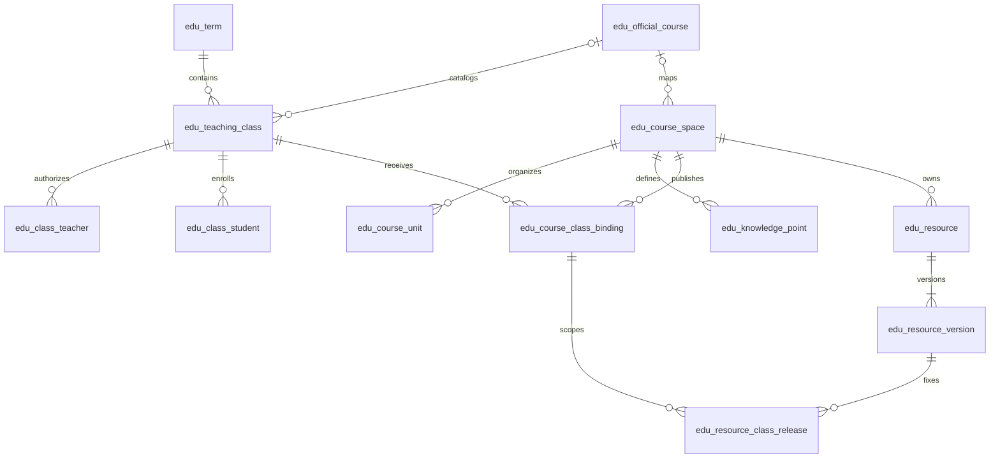

# MySQL 数据库设计草案

> 2026-10-21 · 状态：待业务、后端与数据库负责人评审

本设计以 [原始需求分析](../../智慧教育课程需求分析.docx)、[功能架构优化方案 V2.0](../../功能架构优化方案%20.md)和[教学业务架构](architecture.md)为输入。MySQL 已由项目提出作为数据库；具体服务器版本、若依版本、部署方式和数据保留政策仍待确认。`../sql/mysql-core-schema-draft.sql` 是首条业务链路的物理设计草案，尚未在数据库执行或验证。

## 1. 设计范围

首批物理表覆盖“教师建设课程空间 → 绑定教学班 → 发布指定版本资源 → 班级学生按授权访问”。课程内容与教务正式课程分离；资源本体、版本与班级发布分离；成员变动保留历史。其他教学领域在第 6 节列出拟建对象和关键约束，待业务规则确认后再定 DDL。

| 领域 | 本次物理表 | 责任与用途 |
| --- | --- | --- |
| `course` | `edu_term`、`edu_official_course`、`edu_course_space`、`edu_course_unit`、`edu_knowledge_point` | 学期、正式课程目录、教师内容空间及教学单元 |
| `course` | `edu_teaching_class`、`edu_class_teacher`、`edu_class_student`、`edu_course_class_binding` | 教学班、任课与成员历史、课程空间按班绑定 |
| `resource` | `edu_resource`、`edu_resource_version`、`edu_resource_class_release` | 资源元数据、不可变的内容版本、按班发布与撤销 |

账号、角色、部门和菜单由选定的若依基础工程提供。本草案的 `user_id`、`organization_id` 是逻辑引用；接入真实基础工程前核对其 ID 类型、组织模型与授权接口，不在此伪造系统表或跨模块外键。

## 2. 核心关系

`edu_teaching_class` 以组织、学期和班级编码唯一定位。正式课程目录可关联多个教学班，课程空间可发布到多个教学班；同一班是否允许同时绑定多个课程空间尚待业务确认，因此本草案只限制同一“班级 + 课程空间”不能重复处于有效绑定状态。

## 3. MySQL 物理规则

- 草案语法面向 MySQL 8.0.16 或更新版本的 InnoDB，使用 `utf8mb4`、`CHECK`、生成列和外键。最终版本需与选定若依工程一起确认；低版本不能直接使用此文件。MySQL 从 8.0.16 起支持执行 `CHECK` 约束：[官方说明](https://dev.mysql.com/doc/refman/8.0/en/create-table-check-constraints.html)。
- 教学表主键暂用有符号 `BIGINT AUTO_INCREMENT`，与若依用户 ID 的实际类型在接入前核对。业务编码不是主键；ID 在 API 中如何表示仍需前后端评审。
- 时间列使用 `DATETIME(3)`，服务端和数据库连接按 UTC 写入、比较，界面按用户时区显示。业务截止以服务端时间为准；部署时验证连接时区和迁移会话时区。
- 删除策略以状态、结束时间和受控归档为主。历史成员、绑定、资源版本和发布记录不做级联物理删除；保留期限和依法删除流程待学校确认。
- `valid_to` / `left_at` / `ended_at` / `revoked_at` 为空表示当前有效。带唯一索引的生成列只对有效记录产生非空值，因而阻止重复有效成员、重复有效绑定及重复有效资源发布，同时保留多条结束后的历史。MySQL 唯一索引允许多个 `NULL`：[官方说明](https://dev.mysql.com/doc/refman/8.0/en/create-index.html)。
- 任课授权以 `valid_from` / `valid_to` 记录有效期；角色或发布、评分、导出权限变化时，关闭旧授权并新增一条记录，保留授权人、结束人和原因。学生入退班、课程绑定结束、资源撤销同样保留操作者及原因；不原地改写历史权限。
- 唯一索引只防止同时存在两条未结束的关系；已结束记录的时间区间是否重叠，仍需由服务端在事务中校验并留审计记录。教学班到学期、正式课程的复合外键同时核对组织 ID，防止跨组织关联。
- 仅对教育业务表内部引用建外键。资源发布表用复合外键保证“发布绑定、资源、资源版本”属于同一个课程空间；用户身份、组织归属、教师是否有发布权和成员是否当前有效仍由服务端在事务内校验。
- 教学单元的父子关系由复合外键限定在同一课程空间；循环层级由服务端阻止。MySQL 不允许 `CHECK` 引用自增列，因此不在 DDL 中用 `id` 表达自父级校验：[官方说明](https://dev.mysql.com/doc/refman/8.0/en/create-table-check-constraints.html)。
- 文件字节不进入 MySQL；版本表仅存私有对象键、摘要、大小和处理状态。下载地址由服务端临时签发并再次鉴权，不能将 `storage_key` 当作公开 URL。

## 4. 读写与授权边界

**发布资源时**，服务端先校验任课教师当前权限、教学班与课程空间绑定、资源归属及版本处理状态；在同一业务事务中固定 `resource_version_id` 并写入发布记录。替换内容产生新版本和新发布记录，旧记录以撤销时间结束，历史引用不改指向。

**学生访问时**，服务端同时检查学生当前班级成员关系、绑定未结束、资源发布未撤销、开放和截止时间、版本为可用状态。只找到资源 ID、拥有页面菜单或持有旧下载链接都不足以授权。成员退出或发布撤销后，新请求失去访问资格；历史学习与成绩记录按照保留政策单独处理。

**并发时**，唯一索引负责拦截重复的有效关系；服务端捕获冲突后读取已有记录或返回明确冲突。状态更新使用原状态或版本条件并检查受影响行数，不能靠前端按钮防重。跨表外键保证存在性，但不代替业务授权或状态转移。

## 5. 首批表的验收场景

1. 一个课程空间可以绑定多个教学班；同班同空间并发绑定只保留一条有效记录，结束后可新增历史绑定。
2. 同一学生退班后再次入班形成新成员记录；有效成员唯一，旧参与证据仍可追溯。
3. 资源版本 1 已发布给甲班时，上传版本 2 不改写甲班原发布；乙班不能凭资源 ID 读取甲班发布内容。
4. 资源不属于绑定的课程空间、版本不属于该资源、教师无任课授权或学生已退班时，写入或读取均被拒绝。
5. 未就绪版本、尚未开放、已经截止或已撤销的发布不向学生开放。

上述场景是评审和后续测试要求，不代表已执行测试或已有业务服务。

## 6. 后续领域的拟建对象

| 领域 | 拟建对象 | 建表前必须确认 |
| --- | --- | --- |
| `resource` | 题目、答案与评分量规版本、知识点关联 | 题型、答案公开时点、发布快照和资源审核规则 |
| `prepare` | 备课方案、预习任务、活动模板、目标快照 | 草稿与发布、模板激活、豁免和目标调整 |
| `classroom` | 课堂会话、公开页状态、事件序号 | 独立活动与课堂关系、重连快照、会话并发 |
| `activity` | 活动实例、目标签到/答题记录、修订历史 | 同班同类活动并发、补签补答、服务器截止时点 |
| `assignment` | 统一作业、有效提交与版本、评分修订、成绩发布版本、幂等记录 | 改交次数、迟交、AI 初评与教师确认、撤回更正 |
| `learning` | 去重学习事件、视频有效区间、错题与补学证据 | 心跳判定、跨设备区间去重、原分保留 |
| `analysis` | 指标口径版本、统计快照、预警及证据 | 分母、窗口、样本下限、来源版本和保留期 |
| `ai` | AI 任务、结果建议、调用审计和用量账本 | 模型/模板/知识库版本、权限、输入保留和失败回退 |

作业和活动目标人数必须来自发布时的成员快照及有记录的调整；题目、答案、量规和资源引用固定版本。正式成绩关联提交版本、教师确认与发布版本，AI 建议另存。统计保留口径、分母、样本、窗口和来源，缺失数据不写为零值。这些是后续建表的硬约束，不能由首批资源表替代。

## 7. 待评审决定

1. 确定 MySQL 具体版本、迁移工具、部署和备份恢复要求，并在独立测试库验证 DDL、约束与索引。
2. 对齐若依的用户/部门 ID、账号停用机制、数据权限范围及跨模块事务边界。
3. 确认教学班是否可同时绑定多个课程空间、正式与体验班规则、协同教师可回收的具体权限。
4. 确认资源类型、审核、转换、下架、下载时效与历史版本保留期限。
5. 确认成员变动、资料和学习记录的保留/删除政策；定义迁移回退和不可逆操作的恢复方式。

评审通过后，将草案整理为基线迁移与后续增量脚本，并记录执行环境、结果和回退方案。当前文件不得作为已部署数据库或功能实现的证明。
